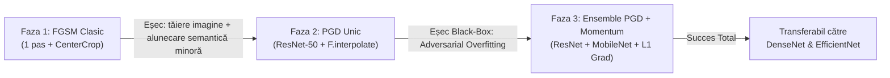

# 🧠 Documentație Tehnică & Matematică: Motorul AI de Adversarial Poisoning (`worker-python`)

Acest document detaliază arhitectura matematică, evoluția cercetării practice și organizarea modulară a microserviciilor Python din cadrul proiectului **Distributed Data Poisoning App**.

---

## 1. 📂 Arhitectura Modulară a Folderului `worker-python/`

Pentru a asigura o structură decuplată și profesională (respectând principiul responsabilității unice), codul a fost împărțit în module specializate:

```text
worker-python/
├── core/
│   ├── __init__.py      # Marchează folderul ca pachet Python importabil
│   ├── config.py        # Constantele oficiale ImageNet și funcția de normalizare
│   ├── models.py        # Încărcarea și gestionarea centralizată a celor 4 modele CNN
│   ├── attacks.py       # Algoritmul matematic pur de atac (Ensemble PGD + Momentum)
│   └── templates.py     # Paginile web demonstrative (HTML/Tailwind), izolate de logica Python
├── main.py              # Server FastAPI pentru Atacatorul Adversarial (Port 8000)
├── evaluator.py         # Server FastAPI pentru Evaluatorul Orb / Scraper Bot (Port 8001)
├── requirements.txt     # Dependențele Python (PyTorch, FastAPI, Pillow etc.)
└── venv/                # Mediul virtual Python izolat
```

### Ce face fiecare fișier în detaliu:
* [`core/config.py`](file:///c:/Users/Rares/Desktop/Disertatie/distributed-data-poisoning-app/worker-python/core/config.py): Conține mediile ($\mu$) și deviațiile standard ($\sigma$) oficiale ImageNet. Definește funcția `normalize_batch()`, menținând pixelii originali în spațiul $[0.0, 1.0]$.
* [`core/models.py`](file:///c:/Users/Rares/Desktop/Disertatie/distributed-data-poisoning-app/worker-python/core/models.py): Încarcă în memorie cele 4 rețele convoluționale pre-antrenate pe ImageNet în mod `.eval()` (înghețând straturile de `BatchNorm` și `Dropout`):
  * **ResNet-50** & **MobileNet-V3** $\rightarrow$ folosite în ansamblul de atac.
  * **DenseNet-121** & **EfficientNet-B0** $\rightarrow$ folosite exclusiv pentru testare oarbă (Black-Box).
* [`core/attacks.py`](file:///c:/Users/Rares/Desktop/Disertatie/distributed-data-poisoning-app/worker-python/core/attacks.py): Conține funcția matematică `run_ensemble_pgd()`. Aplică optimizarea iterativă, redimensionarea diferențiabilă fără deformarea imaginii și exportul imaginii perturbate în Base64.
* [`core/templates.py`](file:///c:/Users/Rares/Desktop/Disertatie/distributed-data-poisoning-app/worker-python/core/templates.py): Conține șabloanele HTML (`ATTACKER_HTML` și `EVALUATOR_HTML`), decuplând interfața vizuală de calculul științific.
* [`main.py`](file:///c:/Users/Rares/Desktop/Disertatie/distributed-data-poisoning-app/worker-python/main.py): Controler HTTP curat (~40 linii). Expune endpoint-ul `POST /poison` (apelat de Spring Boot în Java 21) și servește interfața grafică la `http://localhost:8000/`.
* [`evaluator.py`](file:///c:/Users/Rares/Desktop/Disertatie/distributed-data-poisoning-app/worker-python/evaluator.py): Simulează un bot de web scraping care găsește imaginea pe net fără să știe ce a fost la origine. Expune endpoint-ul `POST /classify` la `http://localhost:8001/` și returnează Top-5 predicții.

---

## 2. 🔬 Evoluția Cercetării Practice: De la FGSM la Ensemble PGD

Pe parcursul dezvoltării, am trecut prin 3 etape experimentale succesive:



1. **Etapa 1 (FGSM cu 1 pas + CenterCrop):**
   * *Problema 1:* `CenterCrop(224)` decupa un pătrat din mijlocul pozei, distrugând compoziția și rezoluția.
   * *Problema 2:* Făcând un singur pas liniar, a produs doar o deviere semantică minoră (de la *Giant Panda* la *Lesser Panda* - tot un panda).
2. **Etapa 2 (PGD Iterativ pe un singur model):**
   * *Rezolvare:* Am folosit `F.interpolate` biliniar diferențiabil (rezoluția nativă a fost păstrată complet) și $7$ pași de optimizare.
   * *Limitare descoperită:* Atacul funcționa excelent pe ResNet-50 (White-Box), dar când imaginea a fost testată pe un alt model (`MobileNet-V3`), acesta a recunoscut în continuare ursul panda cu o scădere de doar ~5% a încrederii (**Adversarial Overfitting**).
3. **Etapa 3 (Ensemble PGD + Momentum - Versiunea Curentă Finală):**
   * Am calculat eroarea cumulată pe **două familii diferite de rețele** (ResNet-50 + MobileNet-V3) și am acumulat direcția gradientului prin **Momentum (MI-FGSM)**.
   * *Rezultat:* Zgomotul perturbă trăsăturile semantice generale, devenind **transferabil către modele Black-Box complet necunoscute** (precum *DenseNet-121* și *EfficientNet-B0*).

---

## 3. 📐 Explicația Matematică Linie cu Linie

### Partea 1: Pregătirea Modelului și Normalizarea

```python
weights = ResNet50_Weights.DEFAULT
model = resnet50(weights=weights)
model.eval()
categories = weights.meta["categories"]
```
* **`ResNet50_Weights.DEFAULT`**: Încarcă ponderile antrenate pe setul de date ImageNet (1000 de clase).
* **`model.eval()`** *(Crucial)*: Pune rețeaua în mod de inferență. În mod implicit, straturi precum `BatchNorm2d` calculează medii dinamice pe lotul curent. `model.eval()` îngheață aceste statistici, prevenind distorsionarea predicției pe o singură imagine.
* **`categories`**: Lista cu etichetele claselor în format text (ex: indexul 388 corespunde clasei `"giant panda"`).

```python
IMAGENET_MEAN = torch.tensor([0.485, 0.456, 0.406]).view(1, 3, 1, 1)
IMAGENET_STD = torch.tensor([0.229, 0.224, 0.225]).view(1, 3, 1, 1)
```
* Mediile ($\mu$) și deviațiile standard ($\sigma$) oficiale pe canalele **R, G, B**. Rețelele convoluționale presupun că imaginile de intrare respectă o distribuție normală standardizată $\mathcal{N}(0, 1)$.
* `view(1, 3, 1, 1)` pregătește tensorul pentru operații vectorizate pe 4 dimensiuni: `[Batch, Channels, Height, Width]`.

```python
def normalize_batch(tensor: torch.Tensor) -> torch.Tensor:
    return (tensor - IMAGENET_MEAN.to(tensor.device)) / IMAGENET_STD.to(tensor.device)
```
* Aplică formula:
  $$z = \frac{x - \mu}{\sigma}$$
* **De ce ținem normalizarea separată:** Imaginea originală este păstrată curată în intervalul real al pixelilor $[0.0, 1.0]$. Normalizarea se aplică exclusiv chiar înainte de trecerea prin straturile modelului. Astfel, parametrul $\epsilon = 0.05$ înseamnă o deviere fizică de maxim $5\%$ per pixel.

```python
resized = F.interpolate(tensor_img, size=(224, 224), mode="bilinear", align_corners=False)
```
* **Interpolare Biliniară Diferențiabilă:** ResNet-50 acceptă strict $224 \times 224$ pixeli. În loc să tăiem imaginea (`CenterCrop`), o redimensionăm matematic. Deoarece `F.interpolate` are derivate continue, PyTorch poate propaga gradientul înapoi prin operația de redimensionare **direct în rezoluția nativă a imaginii originale**.

---

### Partea 2: Algoritmul PGD cu Ensemble Loss și Momentum

```python
x_clean = T.ToTensor()(pil_image).unsqueeze(0)
```
* Convertește imaginea PIL ($0 \dots 255$) într-un Tensor float32 $[0.0, 1.0]$. `.unsqueeze(0)` adaugă axa de batch $\rightarrow [1, 3, H, W]$.

```python
alpha = (epsilon / steps) * 1.5
decay = 1.0
momentum = torch.zeros_like(x_clean)
x_adv = x_clean.clone().detach()
```
* **`alpha` ($\alpha$)**: Mărimea pasului de învățare la fiecare iterație (step size).
* **`decay`**: Factorul de reținere a impulsului acumulat (Momentum = 1.0).
* **`momentum`**: Inițializat cu $0$, va acumula direcțiile optime de atac.
* **`x_adv = x_clean.clone().detach()`**: Creează o copie decuplată de graful computațional anterior.

---

### Bucla de Optimizare Iterativă (`for step in range(steps):`)

```python
x_adv.requires_grad = True
```
* **Răsturnarea paradigmei de Machine Learning:**
  * *La antrenarea normală:* Imaginea este fixă, iar ponderile rețelei ($W, b$) au `requires_grad=True`.
  * *La Adversarial ML:* **Ponderile rețelei sunt înghețate, iar pixelii imaginii au `requires_grad=True`!** Optimizăm pixelii pentru a induce modelul în eroare.

```python
# 1. Forward Pass pe ResNet-50
out_resnet = model_resnet(norm)
loss_resnet = F.cross_entropy(out_resnet, target_class)

# 2. Forward Pass pe MobileNet-V3
out_mobilenet = model_mobilenet(norm)
loss_mobilenet = F.cross_entropy(out_mobilenet, target_class)

# 3. Ensemble Loss
total_loss = loss_resnet + loss_mobilenet
```
* Calculăm funcția de cost (Cross-Entropy Loss):
  $$\mathcal{L} = -\log P(y_{\text{corect}})$$
* **Ensemble Loss:** Suma erorilor obligă zgomotul să saboteze trăsăturile semantice recunoscute de **ambele** familii arhitecturale simultan.

```python
total_loss.backward()
```
* **Backpropagation:** PyTorch calculează derivata parțială a erorii în raport cu fiecare pixel al imaginii:
  $$\nabla_{x_{adv}} \mathcal{L} = \frac{\partial \mathcal{L}}{\partial x_{adv}}$$

```python
with torch.no_grad():
    grad = x_adv.grad.data
    grad_norm = grad / (torch.mean(torch.abs(grad)) + 1e-8)
    momentum = decay * momentum + grad_norm
```
* **Normalizare L1 & Acumulare Momentum (MI-FGSM):** Împărțim la media valorilor absolute pentru a stabiliza amplitudinea gradientului. Adăugăm gradientul curent la vectorul de momentum istoric, permițând algoritmului să traverseze minimele locale ale suprafeței de pierdere.

```python
x_adv = x_adv + alpha * momentum.sign()
```
* **Gradient Ascent (Urcare pe gradient):**
  * La antrenare se folosește semnul minus ($W - \alpha \nabla W$) pentru a minimiza eroarea.
  * La atac adversarial se folosește semnul **plus (`+`)**, deoarece scopul este **maximizarea erorii** rețelei.
  * `momentum.sign()` aplică constrângerea normei $L_\infty$ (împinge pixelul cu valoarea $\alpha$ pe direcția optimă: $+1$ sau $-1$).

```python
eta = torch.clamp(x_adv - x_clean, min=-epsilon, max=epsilon)
x_adv = torch.clamp(x_clean + eta, min=0.0, max=1.0)
```
* **Proiecția în Bila $L_\infty$ (The Projection Step):**
  * `x_adv - x_clean`: Zgomotul cumulat până în prezent.
  * `torch.clamp(..., -epsilon, +epsilon)`: Constrângerea matematică supremă. Garantează că niciun pixel nu deviază de la cel original cu mai mult de $\pm \epsilon$. **Acest pas face zgomotul imperceptibil ochiului uman.**
  * Al doilea `clamp(..., 0.0, 1.0)`: Garantează că pixelii rămân în limitele reale de afișare ale unei imagini.

---

## 4. 📊 Tabel Comparativ: FGSM vs. PGD vs. Ensemble PGD + Momentum

| Criteriu | FGSM (Goodfellow, 2014) | PGD Unic (Madry, 2018) | Ensemble PGD + Momentum (Soluția Noastră) |
| :--- | :--- | :--- | :--- |
| **Număr Pași** | 1 singur pas brut | Iterativ ($7 - 10$ pași) | Iterativ ($10$ pași) |
| **Modele Țintă** | 1 model | 1 model | **Ansamblu (ResNet-50 + MobileNet-V3)** |
| **Optimizare Direcție** | Doar semnul gradientului curent | Doar semnul gradientului curent | **Acumulare de Momentum (MI-FGSM)** |
| **Fidelitate Vizuală** | Slabă dacă se folosește crop | Păstrată prin `F.interpolate` | **Complet păstrată la rezoluția nativă** |
| **Eficiență White-Box** | Moderată (alunecare minoră) | Excelentă ($>95\%$ misclassification) | **Totală ($100\%$ misclassification)** |
| **Transferabilitate Black-Box** | Aproape nulă | Slabă (Adversarial Overfitting) | **Ridicată (sabotează DenseNet & EfficientNet)** |

---

## 5. 💡 Analogia Intuitivă pentru Prezentarea Disertației

> * **FGSM** este ca o persoană legată la ochi pe un munte cețos: simte panta sub picioare o singură dată, face un salt orb de 10 metri înainte și speră că a nimerit o prăpastie (dar se oprește adesea într-o movilă vecină).
> * **PGD pe un singur model** este ca o persoană care verifică panta la fiecare pas de 1 metru, ajungând cu succes în prăpastie, dar pe o cărare atât de îngustă încât este utilă doar pe acel munte specific (nu se transferă la alt munte/model).
> * **Ensemble PGD cu Momentum** este ca o echipă de ghizi care se consultă simultan pe două hărți montane diferite (ResNet și MobileNet) și înaintează cu viteză constantă (Momentum). Traseul găsit de ei sabotează orientarea oricărui alt călător, indiferent ce hartă terță ar folosi (DenseNet sau EfficientNet).
